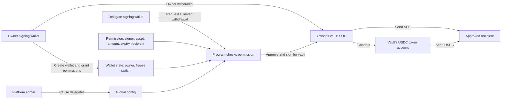
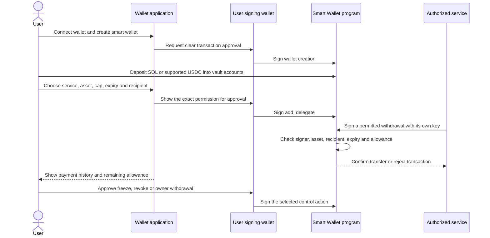

# Smart Wallet: design, live demo, and production roadmap

**Version 0.1.0 · Solana devnet · Verified 1 November 2026, 14:30 IST**

Smart Wallet lets a person keep control of their SOL and tokens while giving
another address permission to spend a limited amount. The person can withdraw
their funds directly, change the permission, or stop the delegate.

This document explains the problem, the system that exists today, the transactions
that demonstrate it, and the work needed to serve real users in production.

## 1. The problem this solves

A payment service, assistant, or automated agent may need to spend on someone's
behalf. Sharing the person's private key gives that service control over all funds.
An application-only spending policy also depends on the application behaving correctly.

This program stores permissions on Solana. Each permission specifies **who can
spend, which asset they can spend, how much they can spend, when permission ends,
and which recipient can receive it**. The program checks those rules for every
successful delegate withdrawal.

For example, a user could authorize a service to pay a particular merchant up to
20 USDC per day for one month. The service signs each payment with its own key;
the user does not need to approve every individual payment. That business example
is a potential use of the implemented permission system; the live demo below uses
smaller amounts and sends the delegate's withdrawals to the delegate itself.

## 2. What exists today

| Item | Current state |
| --- | --- |
| Program version | **0.1.0**, from the Rust package |
| Network | **Devnet**, using test SOL and test USDC |
| Program | [64sQLCxxfgLkTwGGvC8jNq1z4P5H29tTY79EizvpzurH](https://explorer.solana.com/address/64sQLCxxfgLkTwGGvC8jNq1z4P5H29tTY79EizvpzurH?cluster=devnet) |
| Framework | Anchor Rust `1.2.2` |
| Interface | 16 instructions, 3 persistent state account types |
| IDL | Generated `idl.json`; published through the program-metadata program |
| Local verification | 6 Rust unit tests and 15 LiteSVM integration tests passed |
| Live verification | 2 participant wallets; 1 owner access transaction; 2 delegate access transactions |
| Deployment evidence | [Deployment receipt](deployments/devnet.json), [IDL receipt](deployments/idl-devnet.json), [demo receipt](deployments/demo-devnet.json) |
| Production application | Wallet connection UI, payment scheduler, indexer, and recovery service are future work |

The deployed binary SHA-256 verified before the live demo was:

```text
f555eb0696cb83b66e5398066355df550c22652f44755948d84a8246f2ae78e7
```

Documentation and demo scripts were added without changing the deployed program's
instructions or account layout. Version 0.1.0 is a working devnet program; a mainnet
release and independent security audit have not been completed.

## 3. Architecture in plain language

There are two human-facing roles: the **owner**, who controls the funds, and an
**authorized delegate**, who receives limited spending permission. Each has a normal
Solana signing wallet with a private key.

The owner's smart wallet has two separate addresses: a **wallet state account**
that stores control information, and a **vault** that holds SOL and controls token
accounts. These are program-derived addresses, or **PDAs**: deterministic addresses
controlled by program rules, with no private key to hand to the delegate.



Owner withdrawals use their own authorization path and remain available while
delegate spending is paused or frozen. The owner can use that path for either SOL
or tokens. The diagram combines both asset paths for readability.

### Accounts and addresses

| Account | Deterministic seeds | Stores or controls |
| --- | --- | --- |
| Global config | `"config"` | Platform admin, pending admin, delegate pause switch |
| Wallet state | `"wallet", original_creator` | Current owner, pending owner, original creator, freeze switch, delegate count |
| Vault | `"vault", wallet_state` | SOL balance; authority of the wallet's token accounts |
| Delegate permission | `"delegate", wallet_state, delegate_signer, mint` | Limit, window start, spent amount, expiry, allowed recipient |
| USDC token account | Standard associated token account for `(vault, mint)` | USDC balance controlled by the vault |

For native SOL, the permission's mint seed is the all-zero public key
(`11111111111111111111111111111111`). Token amounts use base units: one SOL is
1,000,000,000 lamports, and this USDC mint uses 1,000,000 base units per USDC.

A wallet address is unique **per original creator key**. A person can use multiple
keys, and ownership rotation can give one key control of multiple existing wallets.
The program does not enforce one wallet per real-world person. Wallet and vault
addresses remain unchanged after rotation.

SOL deposits go to the vault, and USDC deposits go to its token account. The wallet
state account is for control information. Token account creation is handled by the
client; the program has no separate token deposit instruction.

## 4. Live demo: two participants and three access transactions

The demo completed on **1 November 2026 at 14:30 IST**. It used Circle's published
[Solana devnet USDC mint](https://developers.circle.com/stablecoins/usdc-contract-addresses),
`4zMMC9srt5Ri5X14GAgXhaHii3GnPAEERYPJgZJDncDU`. These are devnet assets with no demonstrated mainnet value.

### Participants

| Role or account | Explorer link | Purpose |
| --- | --- | --- |
| Owner signing wallet | [8KRs…z65H](https://explorer.solana.com/address/8KRs3MqoHqrucP7QMA4J8CSu8bLd7yg9woxEhvcyz65H?cluster=devnet) | Signs unrestricted owner withdrawals and delegate approvals |
| Delegate signing wallet | [4CN5…cozK](https://explorer.solana.com/address/4CN5qnRTp2vYYVrkGAHaAS16Ud9cV1jH5JpQ5FggcozK?cluster=devnet) | Signs the two limited withdrawals with its own key |
| Owner smart wallet state | [3G9A…PU9F](https://explorer.solana.com/address/3G9A2efN337xuYAMDPstVvHR5ZizxccLqwrwvfKyPU9F?cluster=devnet) | Stores owner identity and permissions count |
| Owner SOL vault | [TqsQ…fy5H](https://explorer.solana.com/address/TqsQF1RWGpxJaiZEFVdQbscx4ixdDBX8xXhcEqGfy5H?cluster=devnet) | Source of the SOL withdrawals |
| Owner vault USDC account | [B5Hh…ZCAt](https://explorer.solana.com/address/B5Hhx1qsWgCQ6uLq68KpCQqtE1WpEvv1duxMraDYZCAt?cluster=devnet) | Source of the USDC withdrawals |
| Delegate's own smart wallet | [dDTt…Xt72](https://explorer.solana.com/address/dDTtRxortS1nENRGUX2yxZG9JbnMQX7jrGPE62RXt72?cluster=devnet) | Created as the second smart wallet; not the source of delegated spending |

Both participants received their own signing key and smart wallet. A delegate does
not need its own smart wallet to spend from an owner's vault; it needs a valid
permission tied to its **signing address**. The second smart wallet was created to
fulfil the two-wallet demonstration. The user's vault remained the source of all
three access transactions.

The sponsor from `.env` funded setup. The owner signed and paid for their own
access transaction; the delegate signed and paid for both delegate access
transactions. The sponsor did not sign any of those three access transactions.

### Permission granted by the owner

| Rule | SOL permission | USDC permission |
| --- | --- | --- |
| Authorized signer | Delegate signing wallet | Same delegate signing wallet |
| Maximum per fixed 24-hour window | **0.02 SOL** | **2 USDC** |
| Actual amount spent in this demo | **0.005 SOL** | **0.5 USDC** |
| Allowed recipient | Delegate signing wallet | Token account owned by the delegate |
| Expiry | 2 November 2026, 14:29:54 IST | Same expiry |

The owner granted two separate permissions in one setup transaction, one per asset.
The two assets have independent spend counters. Unused allowance does not authorize
spending after expiry, and it does not accumulate between windows.

### All transaction links

| Step | What happened | Evidence |
| --- | --- | --- |
| Setup 1 | Sponsor funded signing wallets: 0.05 SOL to owner, 0.03 SOL to delegate | [View transaction](https://explorer.solana.com/tx/ktEaZgfNaSdVkg1Hc2r6uV7yjD1RFqDm1vrDP8Cqk5Q6CNLchbMNM4nuE95QBGY4vayoVFBgBCcGEZ7PE4Cmab5?cluster=devnet) |
| Setup 2 | Owner created their smart wallet and rent-funded vault | [View transaction](https://explorer.solana.com/tx/2yD3T3sbGM211fccbTuZiSUwZniasuHYaVAKVUmBN1DUVq9Bz7XcTaPE6wZ2uPRvma5Npr4rRwfb81BCQDhBbbyX?cluster=devnet) |
| Setup 3 | Delegate created their own smart wallet and rent-funded vault | [View transaction](https://explorer.solana.com/tx/27eATtJh5P9zaUwjzX1HGmH2ubdUcMSmbQHakk1A18pep3EuksFRJng2EWjqeS7rCZEmtkMToyuC6LyQcUiYZr6x?cluster=devnet) |
| Setup 4 | Created USDC token accounts for the owner's vault and both recipients | [View transaction](https://explorer.solana.com/tx/2jjw56vJMFhNK9FvKcToEZJpDufEvzvuz6YjQ911wmtgfaHn4aZQksLcTxRBMJq6DTf3dtpxWWMyEFtKFFekpcBi?cluster=devnet) |
| Setup 5 | Deposited **0.1 SOL + 5 USDC** into the owner's vault/token account | [View transaction](https://explorer.solana.com/tx/5nYxa1WX6jkXGmVrrwgBz1QZA4dT6W7tx1zDyFfzRLu9onAyjrJmXgopz19jDvY1MZ119Ejn9kZWFpFUgZ8SJ2bS?cluster=devnet) |
| Setup 6 | Owner granted SOL and USDC permissions to the delegate | [View transaction](https://explorer.solana.com/tx/3Jetg5wmKe6fkDRiqP8P9dutBymWShUej7UhQqCYnvwzr3ZAYh9KDK1CakJFnW4gxTJUpozYYycefm3FUR3y8Eg9?cluster=devnet) |
| **Owner access: 1 transaction** | Owner withdrew **0.01 SOL + 1 USDC**, with two instructions in one atomic transaction | [View transaction](https://explorer.solana.com/tx/4KgghJFhc7iCbQX9hdA545Jj8SCo6pykgF3GseDGPDbQb1GNHk4xkX35rMRT7TgtRzLxKMceoo3z4eK6tRUm4T8v?cluster=devnet) |
| **Delegate access: transaction 1** | Delegate withdrew **0.005 SOL** to its signing wallet | [View transaction](https://explorer.solana.com/tx/4i2JFpoJ2cXFX1yVFpLMduVV4mPhR9BGtC8QdM4hQf8mk6ga4D8XqkidQaBLvvDvGUr8NQe5TJApH5YXuDNwpANc?cluster=devnet) |
| **Delegate access: transaction 2** | Delegate withdrew **0.5 USDC** to its token account | [View transaction](https://explorer.solana.com/tx/Tba27kj5k6f6BtPKMaVTZsfwvCi6GV15koTf68TfMtjP7e1CYCxDbUtvspq8J2fCNpjHSSBCHLWBCLP6Hc3AJyH?cluster=devnet) |

There were **9 transactions overall: 6 setup transactions and exactly 3 access
transactions**. The owner's single access transaction bundled SOL and USDC
withdrawals: if either instruction had failed, neither transfer would have committed.

### Verified balances and fees

| Balance | Before access | After the three access transactions |
| --- | --- | --- |
| Owner vault: spendable SOL | 0.100000000 SOL | **0.085000000 SOL** |
| Owner vault: retained SOL rent reserve | 0.000650240 SOL | 0.000650240 SOL |
| Owner vault: USDC | 5 USDC | **3.5 USDC** |
| Owner signing wallet: SOL | 0.045026840 SOL | 0.055021840 SOL |
| Owner recipient token account | 0 USDC | **1 USDC** |
| Delegate signing wallet: SOL | 0.028130640 SOL | 0.033120640 SOL |
| Delegate recipient token account | 0 USDC | **0.5 USDC** |

Each access transaction paid **5,000 lamports (0.000005 SOL)** in this run.
The owner received 0.01 SOL minus one transaction fee. The delegate received
0.005 SOL minus two transaction fees. These amounts exclude the earlier setup
costs. Rent and fees are observed devnet values, not a production price guarantee.

The script verified successful transaction status, vault SOL/USDC deltas, recipient
balances after fees, and both delegate spend counters. Addresses, signatures,
slots, snapshots, and timing are preserved in the [public demo receipt](deployments/demo-devnet.json).
The remaining funds are still in the owner's vault and remain withdrawable by its
owner. Delegate access ends at the stated expiry unless changed or revoked earlier.

### Reproduce or inspect the demo

```sh
npm run demo:devnet
```

The script uses `.env` for the funded sponsor. Participant signing keys are stored
locally in `.demo/` with restricted permissions and are excluded from Git. Public
addresses and results are saved in `deployments/demo-devnet.json`.

Running it again with the completed receipt performs no new transfers. To run a
fresh demonstration, retain a private backup of the old participant keys and move
the old `.demo/` directory and receipt aside together. A fresh run spends additional
devnet funds and requires at least 5 Circle devnet USDC in one sponsor token account.
During an interrupted run, checkpoints allow recorded steps to be skipped; inspect
on-chain signatures before retrying if confirmation was uncertain.

## 5. How access is enforced

For an owner's withdrawal, the program checks the owner signature, wallet and
vault addresses, recipient, positive amount, and available balance. SOL withdrawals
also preserve the vault's current rent-exempt minimum.

For a delegate's withdrawal, it additionally checks:

1. Delegate spending is enabled in the global config.
2. The owner has not frozen the wallet.
3. The permission address matches this wallet, signing delegate, and exact asset.
4. The recipient is allowed. For tokens, this means the destination account's owner.
5. Permission has not expired: `now < expires_at`, unless expiry is zero.
6. After any fixed-window rollover, the amount fits the remaining allowance.
7. The vault can transfer the funds without breaking balance or token constraints.

A failed transaction rolls back account and transfer changes, including delegate
spend accounting. A transaction submitted on chain may still pay a network fee
when it fails. Account constraints can reject a transaction before handler checks.

### Permission details

| Parameter | Meaning |
| --- | --- |
| `limit_per_period` | Positive amount in the selected asset's base units |
| `period_secs = 0` | Lifetime allowance that does not reset |
| `period_secs > 0` | Fixed-window allowance, with a maximum period of one year |
| `expires_at = 0` | No expiry; otherwise a future Unix timestamp when granting/updating |
| `allowed_recipient = default key` | Any recipient; use a specific recipient to restrict payouts |

Updates retain the spent amount and existing window start. Lowering a limit can
immediately leave no remaining allowance. Changing the period affects how later
rollovers are calculated. Revocation closes the permission and refunds its rent
to the current owner.

## 6. Current issues, limits, and deliberate choices

| Topic | Current behavior | Implication or next step |
| --- | --- | --- |
| Upgrade authority | Can replace program code | Admin pause restrictions do not constrain a malicious upgrade. Use governed upgrades, a timelock, or an explicit immutability decision before mainnet. |
| Fixed windows | Spending can occur just before and just after a boundary | Two adjacent windows can each be spent near the boundary. A rolling limit would require a different implementation. |
| Delegate compromise | A stolen key can spend within its limits until expiry or intervention | Use short expiries, recipient restrictions, monitoring, and rapid owner freeze/revoke. |
| Owner compromise or loss | Current owner has full control; two-step rotation requires working keys | No social recovery or guardian system is implemented. |
| Rotation | Delegate permissions survive owner rotation | After suspected compromise, freeze and review permissions rather than relying on rotation alone. |
| Wallet closure | No close-wallet instruction | Wallet/vault rent remains reserved; closure could allow the original key to recreate a rotated address. |
| Token-2022 | Basic transfers supported and integration-tested | Transfer hooks need extra accounts and are unsupported. Extension combinations are not exhaustively tested. |
| Test coverage | 6 unit tests, 15 integration tests, this live SOL/USDC demo | Not every account permutation is covered; fuzzing and an independent audit remain future work. |
| Automation | A delegate may sign a permitted payment | Scheduling, payment retries, business rules, and transaction indexing must be built around the program. |
| Business payment identifiers | No application payment ID or invoice deduplication is enforced | A future payment service must prevent a logical payment being submitted twice with different transactions. |
| User experience | Program, scripts, IDL, and receipts exist | A production wallet connection and approval UI is not built yet. |
| Demo key handling | Keys were generated locally for scripted testing | Real users should sign through their own wallet or an explicitly designed custody/recovery system. |

The **platform admin** can pause delegates but cannot withdraw user funds through
these instructions, add their delegates, or block owner withdrawals. The
**upgrade authority** is a separate trust boundary with power to replace code.
In the current deployment, the same sponsor key holds both roles. These roles
should be separated and governed for a production release.

## 7. Future production journey for a real user

The steps below are a proposed application flow around the existing contract.
They are not a claim that a production frontend or payment service already exists.



1. **Onboard.** The user connects a wallet. The app derives the state and vault
   addresses and clearly explains where SOL and USDC deposits go. A connected
   wallet can be different from the account that sponsors transaction fees.
2. **Create and fund.** The user signs wallet creation. The app creates required
   token accounts and displays the vault's SOL address and the correct USDC deposit
   route. A fee sponsor can improve onboarding, but this requires a relayer flow.
3. **Authorize with informed consent.** The app shows the actual service signing
   address, asset mint, cap, fixed-window behavior, expiry, recipient, and network.
   The user signs the grant. The backend does not receive the owner's private key.
4. **Make permitted payments.** The service signs with a protected service or
   session key. The program enforces the on-chain permission; the service enforces
   invoice logic, schedule, deduplication, and retries. A transaction's fee payer
   can be the user, service, or relayer, according to the application's design.
5. **Show trustworthy history.** An indexer records confirmed signatures and
   program events. The app reconciles actual account balances and allowance state,
   distinguishes pending/confirmed/failed payments, and handles RPC interruptions.
6. **Keep control.** The user can withdraw, reduce limits, freeze, revoke, or use
   two-step ownership rotation. Revoking permission prevents future delegated
   withdrawals; it does not reverse payments already completed.
7. **Release on mainnet deliberately.** Deploy and initialize a separately
   identified mainnet program, verify its IDL and binary, use the issuer's mainnet
   USDC mint, and apply tested governance and operational procedures. Devnet
   balances and demo permissions do not migrate into mainnet automatically.

### Production work to complete before handling real user funds

| Workstream | Deliverable |
| --- | --- |
| Security | Independent audit, fuzzing, adversarial account tests, extension policy, reproducible build verification |
| Governance | Separated admin/upgrade authority, multisig or other documented governance, upgrade delay and emergency procedure |
| User experience | Wallet connection, transaction simulation, readable permission consent, deposit guidance, revoke/freeze controls |
| Payment service | Protected delegate signing, scoped service keys, business payment deduplication, safe retries and clear failures |
| Observability | Confirmed transaction indexer, event/history API, balance reconciliation, alerts and incident handling |
| Recovery | A documented owner-key loss process; any guardian/time-locked recovery extension requires design and new tests |
| Release operations | Mainnet program and mint verification, deployment receipts, backups and a tested rollback/upgrade procedure |

## 8. Instruction reference

| Group | Instruction | Required authority |
| --- | --- | --- |
| Platform | `initialize_config` | Program upgrade authority, once |
| Platform | `set_paused`, `propose_admin` | Current platform admin |
| Platform | `accept_admin` | Proposed new admin |
| Wallet | `create_wallet` | Original creator |
| Funding | `deposit_sol` | Any payer; direct vault SOL/token deposits also work |
| Owner control | `set_frozen`, `propose_owner` | Current owner |
| Owner control | `accept_owner` | Proposed new owner |
| Owner access | `owner_withdraw_sol`, `owner_withdraw_token` | Current owner |
| Permissions | `add_delegate`, `update_delegate`, `revoke_delegate` | Current owner |
| Delegate access | `delegate_withdraw_sol`, `delegate_withdraw_token` | Matching authorized delegate |

Admin and owner rotations both use a proposal followed by acceptance by the new
key. A default public key cancels a pending proposal. For code and setup commands,
see the [README](README.md); for the exact current interface, see [idl.json](idl.json).
